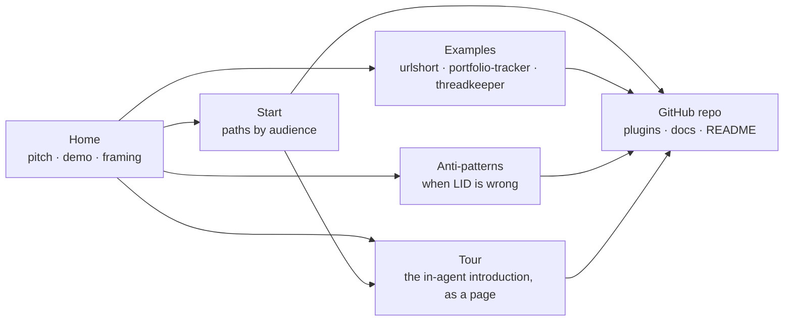

# LLD: Marketing Site

**Created**: 2026-04-18
**Status**: Design Phase

## Context and Design Philosophy

The marketing site is LID's **conversion and orientation surface**. It exists because the README is deep documentation — valuable once a user has decided to invest, costly as a first impression. An evaluator landing on the README meets a dense technical pitch without the framing that would let them recognize whether LID solves a problem they have. The site closes that gap: it carries the positioning, the visual demonstration of plasticity, the honest "when LID is the wrong choice" signal, and the short paths into the real artifacts — and then it hands the user to the README or the repo for everything deeper.

Terms like *arrow*, *segment*, *drift*, and *coherence* are defined in the HLD's Glossary. In this LLD, **content** means the pages and assets the site serves; **chrome** means navigation, layout, and styling around that content.

Two design constraints shape the site:

- **Minimum surface applies to marketing too.** The site is not a second docs destination, not a community hub, not interactive tooling. It is the thinnest artifact that can do conversion and orientation. The same discipline that rejects new commands in the plugins rejects new pages here.
- **The site must not drift from the product.** Content claims (modes, commands, behavior) have to cascade from the HLD and LLDs. A marketing site that says LID has behaviors LID doesn't have is worse than no site at all.

## HLD Trace

This LLD traces upstream to four HLD elements:

- **Goal 5 — "Make LID's value legible to people meeting it for the first time."** This is the direct mandate for the onboarding surface (README, marketing site, examples, and the introduction LID offers inside the agent, which the `tour` segment owns). The HLD names the gap between "heard of LID" and "running LID" as an intent gap at project scale, and designates the marketing site as load-bearing intent that must cascade from the HLD like any other segment. This LLD is the site's realization of that goal for the reader who has not yet installed LID.
- **Approach § Linkage-based Intent Tracking — the two payoffs of linkage.** The HLD names navigation (the arrow walkable in tokens) and attestation (coherence checkable by grep) as linkage's payoffs. The site's verification story — that checking whether code still matches design is mechanical, not a re-read — restates the attestation payoff for an evaluator audience, and may claim it only as far as that section defines it.
- **Goal 3 — "Meet teams where they are."** Adoption friction is the broader problem the site addresses; orientation by audience path (evaluating / greenfield / brownfield / scoped) is the mechanism.
- **Architecture § Distribution.** The HLD names the repository as the distribution mechanism. The marketing site extends that distribution layer with a discoverable on-ramp that does not require having already found the repo.

Goal 5 is the anchor that most directly names the site's reason for existing; Goal 3 and Architecture § Distribution are how Goal 5 is served in practice.

## Component Variant

The marketing site follows the **content artifact** pattern defined in HLD § Key Design Decisions → The arrow for LID itself:

```
HLD → LLD → EARS → content + assets
```

This is structurally identical to the behavioral-skill arrow. The EARS layer is retained because linkage is valuable regardless of artifact kind — spec IDs give the site the same `grep`-addressable intent anchors that skills have, let the site's claims trace back to individual requirements, and make drift between site content and HLD prose detectable as a standard coherence failure. Treating the site as a variant without EARS was considered and rejected: uniform arrow shape keeps LID-on-LID's linkage legible and means the cascade mechanics in `linked-intent-dev.md` apply here unmodified.

The spec file for this segment is `docs/intent/marketing-site/marketing-site-specs.md`.

Verification substitutes content-appropriate mechanisms for test-harness evals:

1. **Build-time structural checks** — link checks, Mermaid rendering, markdown lint. Dead internal links, missing assets, and build failures block deployment. These are the site's equivalent of "tests must pass."
2. **Dogfooding content review** — when the HLD or a plugin LLD changes, site content is reviewed for claim drift. Unreviewed drift is a coherence signal going red under HLD Goal 4.
3. **Spec coverage** — assertions referenced by the EARS specs are checked at build time where automatable (page presence, navigation structure, theme behavior, quickstart command match) and by reviewer judgment where not (content framing, cascade currency, anti-pattern honesty).

## Goals and Non-Goals

### Goals

- **Convert evaluators.** A developer who has heard of LID and wants to know if it solves their problem should leave the site with a clear yes/no and a next step.
- **Orient newcomers faster than the README.** The first five minutes on the site should convey what LID is, the design→specs→tests→code mechanism and its grep-addressable linkage, and which of four paths (evaluating, greenfield, brownfield, scoped) applies to the reader.
- **Demonstrate plasticity.** A ~2-minute asciinema recording shows a real LID session: user states intent, skill produces HLD delta → LLD → EARS → code. The demo carries more weight than any prose about "intent as source."
- **Make verifiability legible.** After "what is this?", an evaluator's second silent question is "agents write code faster than I can review it — how do I trust what landed?" The site answers with the attestation story (HLD § Approach: Linkage-based Intent Tracking): every behavior traces to a spec ID, so checking coherence is a grep, not a re-read. The claim is carried inside existing Home sections — the How-it-works lede, the grep-note, and the outro — never as a separate page or section.
- **Answer the team evaluator.** A reader assessing LID for a team needs "does this work for *us*" answered before install commands: how design alignment happens (intent PRs), how onboarding works (cold-readable docs), how mixed tools coexist (one markdown tree), how a sub-team adopts (Scoped mode), and what happens under incident pressure (hotfix outside the workflow, walk the design back after). The Home Teams section carries these as descriptions of artifact mechanics, never as governance promises.
- **Surface honest non-fit.** An anti-patterns page ("LID is the wrong choice when...") builds trust that the project isn't oversold.
- **Link real examples.** The `examples/urlshort/` intent-only example, the portfolio-tracker complete OSS exemplar, and threadkeeper as a long-running case study are reachable from the site without the reader having to know any of them exists.

### Non-Goals

- **Not a docs site.** The README is deep docs. The site links to it; it does not duplicate or replace it.
- **Not interactive tooling.** No live try-it, no in-browser playground. Interactivity belongs in the user's coding agent itself.
- **Not a community hub.** No forums, no comment threads, no user-submitted content. Community lives on GitHub (issues, discussions) and external channels the user already has.
- **Not a metrics dashboard.** No analytics beyond GitHub Pages defaults. No third-party tracking. No newsletter signup.
- **Not a marketing funnel with calls-to-action for a paid product.** LID is MIT-licensed; the "conversion" is "install the plugin," nothing more.

## Audience

The general LID persona is defined in HLD § Target Users — developers using agentic coding tools who want the agent to compile English into software that actually matches their intent. The site's audience is a narrower cut of that persona: people who have **not yet adopted LID** and may not have encountered spec-driven development in any form. The tone that follows from this audience is *share, not oversell* — a friend who has found an interesting approach, seen real benefits, and is inviting others to try it.

Within that cut:

**Vocabulary on the conversion surface.** The site's reader has not yet learned LID's vocabulary, so methodology terms earn their place only after the thing they name has been shown. First mentions are plain English ("structured one-line requirements, each with a greppable ID") with the acronym arriving after the trace instantiates it; "arrow" is defined in one clause at its first use on a page; internal workflow vocabulary (phase names, audit names, "semantic legibility") stays off the site entirely — it describes LID to its maintainers, not to an evaluator. This serves Goal 5 directly: a claim the reader cannot parse is a claim the site failed to make.

**Copy register.** Five rules govern the site's prose, all serving the same evaluator-trust goal as *share, not oversell*:

- **Headings carry claims.** A persuasive heading — the h2s of the gap, the two explainers, the check-it-yourself section, the section on where your time goes, and Teams, and the Examples and Anti-patterns page h1s — states a claim that traces to a mechanism or artifact shown on its page. The hero h1 is the one sanctioned exception: an interrogative that names the doubt the page answers. Navigational headings (Quickstart, entry paths, ecosystem, the Start page) need only orient. Metaphor lives in body copy, where the thing can be shown before it is named.
- **Honest verbs.** Agent action is always paired with the user's review posture (cascade plus stops). The site never uses hands-off verbs — closes, eliminates, rewrites itself — for work the agent does under review.
- **One authorial sentence.** The site carries exactly one first-person sentence — beside the price passage on the home page, receipt-bearing (the linked public exemplar plus the breadth clause that LID runs on projects the author has never touched) — and the author's name in the footer. Authorial first person appears nowhere else — the Start page's path headings ("I'm evaluating.") speak in the reader's voice, which is quotation, not authorship. One "I" re-registers the site from institutional to personal; more dilutes it.
- **One cost word.** The discipline's cost is named "the price" wherever it appears, on every page.
- **Antithesis budget.** At most two "X, not Y"-shaped constructions across the whole site (currently: the home page's "It looks like a waterfall; it behaves like source code" and Anti-patterns' "Fit problems, not product deficiencies"). Stacked antithesis is the signature cadence of AI-inflected marketing copy; the budget keeps the register human without banning the tool.

- **Primary — evaluators.** Developers who have seen LID mentioned somewhere and want to decide if it's for them. They may already use another spec-driven system; they may not. Site content is optimized for this audience first; every other decision falls out of their needs. The framing the site leads with is LID as **a structured way to write intent for your coding agent** — a layered organization of what you say at different levels of detail, from broad direction down to the granular claims that tests can verify. This framing lands cleaner for cold visitors than "another SDD methodology" because it names what LID *is*, not just what it does. The site never names specific competing systems. Two reasons: the set of comparable tools churns quickly and any named comparison dates fast, and publicly listing competitors is a follower's move that reads as one — a category definer simply describes what it is.
- **Secondary — returning users.** People who installed LID, want a link to send a coworker, or need to re-find a specific concept. The site serves them by being unambiguous and cross-linkable.
- **Tertiary — contributors.** People who want to hack on LID go directly to the repo. The site does not optimize for them; a single link to the GitHub repo is sufficient.

The site explicitly does not serve users *already using* LID day-to-day. Those users have their adapter or plugin installed; they interact with LID through their coding agent, not through a web page.

## Site Structure



Five pages, one outbound destination. The Tour page also has a way in from outside the site: the offer card LID shows inside the agent links to it. The repo is the terminal node — every path eventually ends there, and the site's job is to make sure the user arrives at the repo oriented enough to find what they need.

### Page: Home

The landing page. It follows one feature request from the first screen to the last: the 30-day free trial that the newcomer tour (the `tour` segment) also uses, so an evaluator meets one concrete example rather than a new one in every section, and a reader who later takes the tour meets a familiar one. The order walks a cold evaluator from *what problem is this* through *how does it work* and *what does it look like in motion* before asking them to install anything. A reader who has already decided never has to scroll for the commands, because the navigation's Install button stays on screen (see *Visual identity*). Top to bottom:

1. **Hero: the question, a short answer, and the rings.**
   - The h1 is the intent-gap question, addressed personally: *"How do you know your agent built what you meant?"* It admits the doubt the target reader already carries instead of asserting a metaphor they haven't bought yet, and it is the hero's one guaranteed human beat ("you," "meant"). The h1 is site-owned; the README's opening pitch is a separate, README-owned sentence (see Repository README).
   - Under the h1, two short paragraphs answer it in connected sentences, with no list of fragments, because a run of short lines under a large heading reads as heavy and as slogans. The first states the felt problem in one sentence: when a request leaves a detail unsaid, the agent fills the gap with its best guess, and when the reader comes back later, the agent there won't remember why. The gap section right below shows the same problem concretely, so the hero needs only the one sentence.
   - The second paragraph is the answer. It expands the product name at its first mention, "LID (Linked-Intent Development)"; says that the reader and their agent write the design down in plain English and that everything the agent builds points back to it; states the change-once loop with honest verbs (the reader changes the design once, and the agent carries the change down while the reader reviews each step; never "closes the gap" or self-acting rewrites); and closes with the ceremony disarm: the reader would type the design into the chat anyway, and LID keeps it where their agent can find it next time. The hero copy introduces no methodology acronyms, displays no spec ID, does not use the term "arrow", and names the agent generically; the rings drawing beside the hero text carries no labels at all; its levels are named in the explainer, after it shows them.
   - Beside the hero text sits the rings drawing (see *The rings drawing* below) in its finished state and without labels: nested rounded rings closing on one orange dot in a field of dots. It previews the picture the explainer builds and asks nothing of a reader who skips it. On a narrow screen, where the hero is a single column, the drawing shrinks to a small mark beside the h1. At full width below the actions it would fill a phone's first screen with a picture the reader can't read yet and push the gap section further down.
   - Two actions: Install (the primary, anchor-linked to the Quickstart) and Read the source.

2. **The gap.** A short section that makes the intent gap concrete before any LID word appears. A one-line request, shown as a message from the reader to their agent, *"Give new users a 30-day free trial."*, is followed by the decisions it leaves to the agent: when the trial starts, what happens when it ends, whether someone can start a second trial, and when exactly day 30 ends. The last carries the example's sharpest edge, a signup at 11 p.m. on the 1st in Tokyo, which the explainers resolve and later return to. The section also says why the reader's existing checks miss this: green tests can't catch the misreading on their own, because an agent writes its tests from the same guess as its code.

3. **Each level you write down rules out what you didn't mean (the narrowing explainer).** A scrolling explainer: the rings drawing stays in view beside a column of short cards, and the card the reader has scrolled to sets what the drawing shows. The section lede says once that each level of design is a constraint on what the agent can build, drawn as a ring around the programs it still allows. The cards, in order:
   1. **The request**, told conversationally: the agent could build it many ways (a trial that starts at signup or at first use, ends at the server's midnight or after exactly 720 hours), and each possible program is a dot.
   2. **Why**: the high-level design's goal line, *"New users can try the app free for 30 days before they pay."*
   3. **Which way to lean**: a tenet, written the way a project writes one, as a preference between two good options in the HLD template's form: *"**Customer delight over perfect cost management.** When a choice could go either way, we lean toward the customer."* The newcomer tour uses the same tenet in the same example. The card says another business could reasonably choose the other side, and that this tenet rules out ending trials at the server's midnight, which would cut the Tokyo signup's trial 14 hours short. In the drawing the tenet is a hatched region of the HLD's ring, ruled out ahead of time.
   4. **How**: the low-level design's rule, *"The trial ends 720 hours after signup."*
   5. **The rules**: three requirements in EARS form, `TRIAL-001` (when a new user signs up, start a trial), `TRIAL-002` (while a trial is active, give full access), and `TRIAL-003` (when 720 hours have passed since signup, end the trial). Each is a smaller ring, the program has to sit inside all of them, and a few programs still fit their overlap. Only `TRIAL-003`, the requirement the page follows, is labeled in the drawing.
   6. **Test first, then code**: a short test that cites `TRIAL-003` in an `@spec` comment and uses the Tokyo signup. The test is drawn as a target on one program; it fails until the code lands there, as the orange dot, and a dotted `@spec` link ties the code to `TRIAL-003`.

   Each document level appears as a small file excerpt under its repository path (`docs/high-level-design.md`, `docs/intent/trial/trial-design.md`, `docs/intent/trial/trial-specs.md`, `tests/trial.test.ts`), so the reader sees each level as a file in their own project, never as a rule LID imposes on every project. The reader's requests appear as chat messages. Each card shows what a level does before naming it, per the vocabulary rule in *Audience*.

4. **Change your mind in one place (the change explainer), then the recording.** The section admits the volume first: that may feel like a lot to write down for one free trial, and it pays off when you change your mind. The same drawing then follows a change to the same rule the page has followed all along, in four cards:
   1. **Say what should change**: *"End trials at midnight in each user's own time zone."* The low-level design no longer says what the reader means, so the agent re-checks the decisions built on it; the LLD's ring and the requirement rings inside it turn to being re-checked.
   2. **Check what still holds**: the agent checks the change against the levels above it. New users still get 30 days free and the tenet still favors the customer, so the HLD and its tenet hold, and they mark out where the new design can go.
   3. **Find the new design**: the request leaves one question open, *which midnight?*, and the agent drafts two answers, shown as two numbered options the way an agent asks a question. Draft 1 (midnight on day 30) runs into the tenet and is ruled out, because a late-night signup would lose most of a day. Draft 2 (the first local midnight after 720 hours) gives everyone at least 30 full days, and the reader approves it at the pause. The options hold only the drafts; the reasons appear below them as the drawing reaches each one.
   4. **Follow the ID down**: the agent searches for `TRIAL-003` and finds the test and the code that cite it. `TRIAL-001` and `TRIAL-002` still hold and stay where they are; only `TRIAL-003` changes. Its test changes and fails, then the code changes and the test passes.

   The change is drawn as a search inside the limits that still hold, not as a move to a known spot: the reader knows the design has to change but not exactly where it lands, and finding that is the agent's drafting and the reader's review. The section h2 states the claim, *"Change your mind in one place, and the agent carries it down."* The asciinema recording follows under *"Watch it happen in a real project"*: about two minutes of a small HLD or LLD edit in a live LID project propagating through specs, tests, and code. A feature-build recording was considered and rejected because feature builds look like any other spec-driven workflow; the cascade is what differentiates.

5. **Check it yourself.** The verification claim, on the example the reader now knows. `grep -r TRIAL-003` returns the requirement line, the test that asserts it, and the code that implements it, so checking that code still matches design is running that search, not re-reading the codebase. The claim stays bounded in two halves: checking that the code still traces to the design is mechanical, a walk through the links honest enough for CI, while whether the design says what the reader *means* stays a human call. It sells the mechanism, never the conclusion that agent-written code is therefore trustworthy. A bridge then scales the picture from one feature to a whole codebase: each traced path from a design to code is what LID calls an *arrow* (defined in one clause here, at its first use), and every design, requirement, test, and file together form one graph, shown as the DAG figure. The DAG's edges carry arrowheads, so the cascade direction is unambiguous, and two edges between the Tests and Code tiers are drawn in the accent color to show the overlap that makes it a graph: one test can cover more than one file, and one file can be covered by more than one test. A legend beside the figure says what the orange edges mean, because color alone doesn't explain itself.

6. **Where your time goes, and the price.** The h2 is a claim: *"Your time goes into the design."* The section names the locus of work concretely: the reader spends time in the HLD and, most often, the LLDs; the requirements, tests, and code are drafted by the agent and reviewed rather than hand-written; application changes and bug fixes both route back to an LLD edit. It states that the five levels are not a one-way sequence: every level stays editable for the life of the project, and an edit at any level recompiles what is below it. It states the review posture: the reader reviews intent and the agent's proposed deltas, and the links are what let them, an audit pass, or a fresh agent with no context verify that what landed traces to what was written down. Then the price, as a literal price list under the label *the price*: every change walks design, specs, tests, and code with the reader reviewing at each step; reading shifts toward design diffs; the agent spends extra tokens keeping the links current. The trade sentence follows, then the receipt as its own short paragraph, the site's one authorial first-person sentence (see *Copy register*): the author pays this price herself, the largest of her projects being the public portfolio-tracker exemplar (about 63k lines of Rust, about 350 specs, a CI gate that fails the build on uncited specs), and LID now runs on plenty of projects that aren't hers.

7. **Teams.** A compact section carrying how LID behaves when more than one person holds the intent. Its beats, each grounded in a property the artifacts already have rather than a capability claim:
   - **Intent review runs through pull requests.** Because intent is files in the repo, design alignment uses the tool teams already trust: a teammate PRs a change to an HLD or LLD, and the deep design conversation happens there — on a one-page design diff, before implementation, instead of across a large code review after the decisions are baked in. Once the intent lands, anyone on the team cascades it to implementation.
   - **The intent tree is the onboarding surface.** Docs written to be read cold (the *docs carry current intent* tenet) are, by the same property, onboarding docs: a new teammate reads the HLD and the LLDs they will touch, and the *why* travels with the repo rather than with whoever wrote it.
   - **Mixed tools share one source of truth.** The tree is plain markdown in the repo; teammates on different coding agents read and cascade the same intent. No per-tool lock-in.
   - **Sub-team adoption is explicit.** Scoped mode is framed here as how a sub-team adopts inside a larger organization — the scope boundary is declared, not improvised.
   - **Hotfixes are handled honestly.** Urgent fixes go out outside the arrow; when the fire is out, the change is walked back through the design so the intent catches up. The arrow is a source-of-truth discipline, not a deployment gate.

   The section sits between the price and the Quickstart: a team evaluator needs "does this work for *us*" answered before install commands. Register is the same share-not-oversell as everywhere else — these are mechanics of files and git, described, not governance promises.

   At desktop widths the section is a two-column pair: a **design-diff figure** (an LLD edit under review — a few diff lines and a resolved comment thread) on the left, the beats as numbered clauses on the right. The figure shows the section's headline claim rather than asserting it. Its modeled doc text obeys the *docs carry current intent* tenet — diff lines are state-declarative ("guest carts expire after 30 days"), never change-narrating ("guest carts keep the 30-day window") — because the figure models a LID design doc and readers will copy what it shows. The review-thread dialogue may reference change; conversation is not the doc.

8. **Quickstart.** The actual install commands, copy-pastable, with a one-line explanation per step. Placed after the explainers and the price: a cold evaluator needs a mental model before commands (see the *Home section ordering* decision row). The hero's Install action anchor-links here, and so does the navigation's Install button on every page. Commands stay in sync with the README's Quickstart; if the two disagree, the README is authoritative and the site cascades to match.

9. **Experimental and ecosystem.** Two short sections between the Quickstart and the paths: the opt-in `lid-experimental` plugin (named, with its install command, framed as outside the core install path, linking to its README) and the third-party ecosystem link-out (see *Ecosystem as social proof*).

10. **Four path links.** Evaluating / Greenfield / Brownfield / Scoped. Each is a short paragraph with a "continue on the Start page" link.

The hero's actions include "Read the source" beside Install; the page has no separate terminal call-to-action. The single-CTA discipline is preserved: "install and use" remains the only action the site asks for. The secondary label is "Read the source" rather than a generic "On GitHub" because the target audience trusts "read the source" as an invitation to inspect rather than as a download prompt.

#### The rings drawing

One drawing carries the home page's picture of narrowing, in the hero and in both explainers. It draws every program that would satisfy the request as a dot in a field, and each level of design as a ring around the dots it still allows. The rings are rounded rectangles with the corner proportions of the logo's tiles, so the drawing reads as part of the same family as the logo.

- **Marks.** The high-level design's ring is the widest, with the tenet as a hatched strip inside it; the low-level design's ring sits inside, clear of the strip; the requirement rings overlap inside that. Every ring's corner radius is a fifth of its shorter side, the logo tiles' ratio. A dot fades further for each constraint it breaks: each ring it falls outside, and the tenet's strip if it falls inside it. The test is a crosshair target on one program, dashed while the test fails and solid once it holds; once it holds, the other programs in the requirements' overlap fade, because the test picks one of them. The built code is the one orange dot, and a dotted `@spec` link runs from it to `TRIAL-003`'s label.
- **Labels.** A ring's label (HLD, tenet, LLD, `TRIAL-003`) appears with the card that names its level, so no label arrives before its meaning. Of the requirement rings, only `TRIAL-003` is labeled. While the agent searches for a new design, the LLD's label names the draft the ring is showing: *draft 1*, then *draft 2*.
- **A ring being re-checked rules nothing out.** When a change puts a level in question, its ring and the rings inside it turn orange and dashed, and they stop ruling programs out until they settle, so the field inside them brightens again: what the agent could build opens back up while the design is in question. The code they held turns hollow and the test's target lifts, because the built program is no longer known to be what the reader means.
- **A check means the level holds after the change**: a level above the change that still holds, a requirement the change leaves alone, and a level in its new place once the reader approves it. An orange ✗ marks a draft that a level above ruled out; it sits on the ring while the ring shows that draft.
- **Following the ID.** In "Follow the ID down", the `@spec` link turns orange before anything moves, because searching for the ID is how the agent finds the test and the code. Then `TRIAL-003`'s ring moves, the target follows it (the test fails), and the code lands in the target (the test passes).
- **One source.** A single script module both renders the drawing's finished state to static SVG at build time and animates the explainers in the browser, so the hero, the explainers' no-JavaScript fallback, and the animation cannot drift apart. The field of dots comes from a seeded generator, so it is the same on every load.
- **Without JavaScript**, every explainer card reads in full and each explainer's drawing shows its finished state. The hero needs no JavaScript.
- **With reduced motion**, the drawing still changes with each card, without animating between states.
- **The cards carry the whole argument in text.** The drawing illustrates it but is never the only place a point is made, and each drawing has a text description of what it shows.
- **Within the non-goals.** The explainer keeps no state and takes no input beyond the reader's scrolling; it is an illustration paced by the reader, not a playground, so it sits inside *Not interactive tooling*.

### Page: Start

Audience-path orientation. Four short sections:

- **Evaluating LID?** — "Read the README. Skim the HLD. Try `examples/urlshort/`. Clone portfolio-tracker to see the full arrow with its coverage gate." This audience wants to validate the claims before committing.
- **Starting a new project?** — Greenfield onboarding: install plugins, then invoke `/linked-intent-dev` with a description of what you want to build (the workflow bootstraps LID as part of Phase 1).
- **Adding LID to an existing codebase?** — Brownfield onboarding: same install, plus `/arrow-maintenance:map-codebase` with a token-intensity warning.
- **Scoped to one subsystem?** — Scoped LID introduction: when the team hasn't adopted and you're trying it on a slice. Explicitly links to the HLD's modes section.

The Start page also surfaces **`/lid-coach`** — the core `linked-intent-dev` plugin's principle-review skill — as a cross-path capability rather than a fifth audience section. The coach is not an audience path (it reviews an *already-running* LID project against the methodology's principles) and not an install step, so it earns a mention inside the narratives where it is useful — the Evaluating path (so an evaluator knows the methodology ships its own coach) and the Greenfield path (run it once a few components exist) — rather than its own section or a place in the Home Quickstart. Surfacing it is a coherence requirement, not a marketing add: it is a core, mandatory skill, and omitting it while the site already surfaces `/update-lid` and `/map-codebase` would advertise two of three core skills and hide the third.

Each section is short (~150 words). Depth is a README click away.

### Page: Examples

Three cards, each linking out. Each card answers a different evaluator question, and the three are framed as lenses, not a ranking:

- **`examples/urlshort/`** — small, intent-only, "regenerate from these docs" demo (HLD + LLDs + EARS, no code). Labeled as "clean, minimal, 5-minute read." The example exists in the repository at `examples/urlshort/` and is linked directly.
- **Portfolio-tracker** (`github.com/jszmajda/portfolio-tracker`) — a complete public OSS project built with LID end-to-end: HLD, eleven LLDs, 350 EARS specs, `@spec`-cited tests and code, the `docs/arrows/` overlay, and a CI coverage gate that fails the build unless every spec is cited by at least one test and every citation resolves to a defined spec. Labeled as "complete, real, end-to-end." Its conversion role is specific: it is the roster's existence proof for the site's verification claim — the grep-note *describes* checking code against design mechanically; portfolio-tracker *enforces* exactly that in public CI. The card points at the project's own README, which carries a five-file guided tour reading down one arrow segment.
- **Threadkeeper** — long-running real-world project that uses LID. Labeled as "messy, real, instructive." Linked only if the project is public or excerpts can be shared with the maintainer's permission.

A short intro paragraph explains the difference: the clean example for understanding the system; the complete example for seeing the whole arrow landed in real code; the messy example for understanding how the system ages. The page h1 is receipts-first in the claim register — *"Three projects. Two you can grep today."* — accurate to the roster: urlshort and portfolio-tracker are browsable; threadkeeper is closed-source.

### Page: Anti-Patterns

Honest list of when LID is the wrong choice. Starting set (to be refined from real user feedback, not guessed indefinitely):

- One-week prototypes and throwaway scripts
- Exploratory research code where intent is genuinely unknown at the start
- Teams unwilling to review specs before implementation lands
- Projects where English-as-source is a hard sell — compliance, auditing, or formal-methods contexts that require code as the canonical artifact

The page frames these as *fit problems*, not deficiencies in LID. A user who recognizes their own project in this list is served better by seeing "LID is not for you" than by adopting and finding out later. The page h1 names the tradeoff in the site's single cost word: *"When the price isn't worth it."*

### Page: Tour

The newcomer tour's five steps and its topics as one page, at `/tour`, and one of the site's five top-level pages. The introduction LID offers inside the agent (the `tour` segment) has readers who would rather leave the agent to read it, and hosts without a plugin system reach the tour most simply through a link. The offer card in the agent links here, and the Start page links here for a reader who wants to see how LID works before installing it.

- **The content comes from the `tour` segment.** The site's build reads the steps from `plugins/linked-intent-dev/skills/linked-intent-dev/references/tour.md`, at the commit being built, and renders them, so the page and the in-agent tour share one source. The site does not edit or paraphrase them.
- **Agent-only parts are left out**: the **next** and **done** choices, the **trace** offer, the notes, and the instructions to the agent. The tour files mark them.
- **A "Going further" section** follows the steps, built the same way from the topics in `tour-topics.md`, with a list of the topics' titles at its top.
- **Each step and each topic reads as its own screen.** A short rule and some space sit between one step and the next, and between one topic and the next, the way each step arrives as its own message inside the agent.
- **A sidebar for quick navigation.** On a wide screen, a sidebar on the left of the content links to each step, to "Going further", and to each topic, and stays in view as the page scrolls. On a narrow screen, the same links sit in a collapsible list above the content, so the page never gets squeezed into two columns.
- **The page says which LID version** its content comes from, taken from the plugin manifest at the commit being built.
- **Fenced code is colored the way the tour expects from a host**: a `diff` fence in red and green, and language-tagged fences in syntax colors, in both themes.
- **The page's claims and words are the tour's.** The `tour` segment traces the claims to the HLD and holds the text to its own word rules, so the site's copy rules for its other pages do not apply to it. The site's other pages keep any claim they share with the tour consistent with it.

## Visual identity

**The logo.** LID's logo is the Nodes wordmark: the letters L, I, and D cut out of three rounded tiles, each tile pointing to the next like a linked list, with a slab I (the I with top and bottom bars, as in most coding fonts). It is drawn from shapes, with no font. Its palette, palette A, is an orange ground (`#FF6B3D`) under brown-black ink (`#1A0F0A`), and that palette belongs to the logo: the wordmark always appears on its own orange ground, in both themes, and the site's own colors are chosen separately. Square uses (the favicon, stickers) take the flush-cut L: the Nodes L with the solid pointer cut through it at 40% of its height, starting flush with the stem. The source files, the other palettes, and every exploration that led to the logo live in `site/brand/`, outside the Eleventy build.

**The look: content as linked nodes.** The site carries the logo's idea into its layout. Content sits in rounded nodes on a quiet neutral ground, and the logo's pointer joins things that lead to one another: the bullets of the hero framing, the path links, the reader's way through a sequence. Outside the rings drawing, orange appears as a fill in only three places, the logo, the icon, and the primary Install button; elsewhere it is the pointer glyph. Inside the drawing, orange marks the built code and anything that is changing. Text is the logo's brown-black ink in the light theme and a warm off-white in the dark theme, with neutrals biased slightly warm to sit beside the orange.

**Type.** Geologica, a geometric sans whose sturdy shapes sit well beside the logo's letters, for headings and text; Spline Sans Mono for code, file paths, and the drawing's labels. Both load from Bunny Fonts (`MKT-SITE-030`), with system fallbacks for first paint.

**Buttons.** The primary action is an orange pill with ink text; the secondary action is an outlined pill. Pills are kept for actions, and no content node is a pill, so a button never reads as part of a drawing.

**Navigation.** The navigation stays at the top of the screen on every page: the wordmark (linking home), the five pages and GitHub, and an Install button that links to the Home Quickstart. On a narrow screen the page links collapse into a button labeled Menu, which opens a card of links and works without JavaScript; the Install button stays beside it. Five pages fit in one row on a desktop, so a sidebar or bottom bar would add weight without adding reach.

**Footer.** The flush-cut icon, the author's name and the license, and the line saying the site is itself a segment of LID's arrow, linking to this LLD and its specs.

## Repository README

The repository `README.md` is this segment's second orientation surface — the site converts a visitor who has *not yet* found the repo; the README orients the developer who already has. The two share the Quickstart commands (README authoritative per `MKT-SITE-008`), which is why the README is owned here even though most of this LLD describes the site. The pitch sentences are surface-owned and deliberately unsynchronized: the site h1 is the intent-gap question for a visitor who has never seen the repo, while the README's opening orients a developer already inside it.

The README's positioning body carries the same two-payoff linkage story as the site — navigation and attestation, cascading from HLD § Approach: Linkage-based Intent Tracking. The intent-gap pitch leads both surfaces; the attestation beat sits in the body as the answer to "how do I trust what the agent wrote?", never replacing the cold-open. The one-sentence pitch itself is unaffected by this beat. The README states the beat in its own register — a short positioning passage, not a mirror of the site's three-element pattern; coherence between the two surfaces is by claim (both say what HLD § Linkage says), not by structure, and is checked by the same claim-drift review as every other shared fact.

### Badge row

The README opens with a compact badge row — the at-a-glance credibility and orientation signals a developer scans before reading prose. It serves Goal 5 (legibility to those not yet using LID) at the repository surface the same way the hero serves it on the site, in the same *share, not oversell* register: status and orientation, not a wall of vanity metrics.

The badges:

- **License** (MIT) — the terms the project ships under; links to `LICENSE`.
- **GitHub stars** — modest social proof; links to the stargazers.
- **Works with Claude Code** — names the richest integration and the primary install path; links to the Quickstart.
- **Website** — the `linked-intent.dev` on-ramp; links to the site.
- **PRs welcome** — signals an open contribution posture; links to `CONTRIBUTING.md`.
- **Built with LID** — the self-referential dogfooding signal (this repository is the canonical LID-on-LID reference); links to the HLD.

Two constraints carry down from the site's posture. Badges are served as images and **must not introduce third-party tracking**; GitHub proxies README images through its own cache, so shields-style badges satisfy the no-tracker posture (`MKT-SITE-031`) without a request path to the badge host on the reader's behalf. And each badge **traces to a fact already owned in the arrow** — the license, the repository's own star count, the marketplace install path, the site domain, the contributor guide, the methodology. A badge that asserts a metric the project does not own or cannot keep true (build status, coverage, package downloads, a hand-kept version) is drift and is not added; LID has no such surface to report on. Badges are a README-only treatment and do not appear on the site.

## Ecosystem as social proof

LID's third-party extension ecosystem is owned by the `extensions` segment, which makes it discoverable and curates `EXTENSIONS.md`. This segment owns a *different use* of that ecosystem: **surfacing it as a trust signal** — evidence to a not-yet-user that LID is in real use and has community traction. That is conversion work, so it belongs here, not in `extensions` (whose substance is the convention and the showcase, upstream of any marketing use).

Concretely, the onboarding surface (at minimum a line in the README; a richer site element when a frontend pass adds it) points at the ecosystem — the curated `EXTENSIONS.md` and the `github.com/topics/linked-intent-development` topic — framed as "projects building on LID," the same way the Examples page points at `urlshort` and threadkeeper for conversion without owning them. Placement is a `frontend-design` detail; the intent is a single curated link-out, not a feed. This stays inside *Not a community hub* (`MKT-SITE-021`): a maintainer-curated pointer, not user-submitted content or a forum. The ecosystem's substance — what counts as an extension, how discovery works — stays with `extensions`; this segment only borrows it as proof.

## Tech Stack

### Location

Site lives at `site/` in the repo root. Reasoning:

- **Corporate-clone friendly.** Users whose environments disallow third-party plugin sources clone the repo directly; `site/` comes with them.
- **Single source of truth.** The site's content cascades from `docs/high-level-design.md` and the LLDs. Keeping them in the same repo makes that cascade a local review, not a cross-repo sync.
- **Discoverable.** `site/` at the repo root is obvious to contributors who want to edit it.

A separate `jszmajda/lid-site` repo was considered and rejected — it optimizes for cleaner release cycles at the cost of drift surface. Drift surface is the enemy; release cycles are not a pressure at this stage.

### Framework

**Chosen:** Eleventy (11ty).

Rationale:

- **JavaScript toolchain** matches what most LID users already have locally (Node.js is a common dependency for agentic coding projects).
- **Small API surface.** 11ty is close to "markdown plus a templating engine" — adds little complexity over plain markdown.
- **Native mermaid rendering** via `@11ty/eleventy-plugin-mermaid` or equivalent, matching LID's default diagram format.
- **Fast builds** at our scale; GitHub Pages can host the output directly.

Alternatives weighed and rejected: Jekyll (Ruby toolchain, GitHub Pages default but an extra ecosystem for most users to learn); Astro (heavier, more capability than the site needs — violates minimum-surface); plain markdown rendered by GitHub's native viewer (no build step, but loses the ability to embed mermaid and asciinema cleanly and loses control of the visual treatment).

### Styling and theme

**System-aware theme.** The site respects the user's OS theme preference via the `prefers-color-scheme` media query (`MKT-SITE-024`). When the user has no preference set, the site defaults to the dark theme (`MKT-SITE-025`). Both themes meet WCAG AA contrast (`MKT-SITE-026`).

**Design discipline delegated.** Visual design is produced with the `frontend-design` plugin's skill rather than specified pixel by pixel here. This LLD names the intent (*Visual identity* above: the logo and its palette, content as linked nodes, the type, the buttons, the navigation) and the skill produces the concrete design. This keeps design decisions in tooling optimized for them and keeps this document out of pixel-level specification.

**Typography note.** The site loads typefaces from a no-tracking service (Bunny Fonts); a system-font-only stack was considered and rejected for cross-platform rendering drift. Self-hosting the `woff2` files is a future hardening step; the privacy posture is preserved either way since no tracking occurs.

**Constraints the design skill must honor:**

- The logo's palette stays on the logo, and outside the rings drawing, orange fills appear only in the logo, the icon, and the primary button.
- Typefaces from a no-tracking service (Bunny Fonts) or self-hosted, per `MKT-SITE-030`.
- Accessible contrast ratios in both dark and light themes.
- Fast first paint and small, deliberate JavaScript: the rings drawing's module, copy-to-clipboard, and nothing that a page needs in order to be read. No client-side framework.

### Hosting

GitHub Pages. The `site/_site/` build output is deployed via a GitHub Actions workflow on merge to `main`.

Domain: `linked-intent.dev` — Cloudflare registrar, DNS-only (no proxy), GitHub Pages backend. (See the Decisions table.)

### Mermaid

Rendered at build time. Client-side mermaid rendering is rejected because it adds a JavaScript payload and a flash-of-unrendered-content on every page that includes a diagram. Build-time rendering produces SVG directly in the output HTML.

### Asciinema

Embedded via asciinema.org's official embed snippet. Self-hosting the asciicast player was considered and rejected — the file sizes are small enough that CDN cost is not a concern, and the embed handles the player UI, keyboard controls, and accessibility for free. The underlying `.cast` file is committed to the repo so recording provenance is tracked.

## Cascade Concerns

The site is downstream of the HLD and the plugin LLDs. Changes propagate as follows:

- **HLD change** — site content is reviewed for claim drift (modes, framing, goals, non-goals). Drift is a coherence signal the dogfooding check catches.
- **LLD change** — the Start page's path descriptions are reviewed (they describe `/linked-intent-dev`, `/update-lid`, `/map-codebase`, and `/lid-coach` behavior at a high level). If a command's behavior changes materially, the Start page must cascade. A new or promoted core skill is itself an LLD-level change that cascades here — the onboarding surface lists the core skill roster, so a change to that roster (as when `/lid-coach` joined the core plugin) must reach this segment.
- **Skill behavior change** — the asciinema demo is reviewed for currency. If the demo shows behavior the skills no longer produce, it is re-recorded.
- **`tour` change** — the Tour page rebuilds from `tour.md` and `tour-topics.md`. When the tour's steps change, the page is checked by eye in both themes.
- **Anti-patterns change** — driven by user feedback (issues, surveys, case studies), not by HLD changes. Anti-patterns cascade *up* into the HLD only if the feedback reveals a genuine non-fit the HLD didn't anticipate.

The site is therefore a legitimate arrow segment in the LID-on-LID dogfooding claim. Drift between the site and the HLD/LLDs falls under Goal 4's coherence signal.

Once `docs/arrows/` is bootstrapped for this repository, the site appears as a **named segment** in `docs/arrows/index.yaml` (`MKT-SITE-036`) — on the same footing as the `linked-intent-dev` and `arrow-maintenance` plugin segments. The segment is auditable under `/arrow-maintenance` alongside the rest of the arrow, which is what makes Goal 5's claim about the onboarding surface operational: coherence here is checked by the same mechanism that checks everything else.

## Content Maintenance and Review

- **Build CI.** GitHub Actions runs on PRs that touch `site/` — link-check, mermaid render, markdown lint. A failing build blocks merge.
- **Scheduled dogfooding review.** The `arrow-maintenance` overlay, once bootstrapped for this repo, includes the site as a segment. Periodic audits catch drift.
- **Owner.** The site has one owner (the repo maintainer) rather than distributed authorship. Community contributions via PR are welcome; ownership keeps voice consistent.

## Decisions & Alternatives

| Decision | Chosen | Alternatives Considered | Rationale |
|---|---|---|---|
| Site location | `site/` in the main repo | Separate `jszmajda/lid-site` repo; GitHub wiki; README-only | Corporate-clone friendliness, single source of truth for cascade, minimal release-process overhead. |
| Static site generator | Eleventy (11ty) | Jekyll; Astro; plain markdown on GitHub; Docusaurus | Small API surface, JS toolchain matching users, native mermaid, fast builds. Jekyll loses on ecosystem match; Astro on surface growth; plain markdown on diagram rendering; Docusaurus is a docs framework we explicitly don't want. |
| Mermaid rendering | Build-time | Client-side JS | Build-time avoids JS payload, flash-of-unrendered, and accessibility edge cases. |
| Asciinema hosting | asciinema.org embed | Self-hosted player; animated GIF; video host | Embed handles player UI, controls, accessibility for free. Casts are tiny. GIFs are inaccessible and lossy; video hosts add third-party tracking we don't want. |
| Analytics | GitHub Pages defaults only | Plausible / Fathom; Google Analytics; none at all | Defaults give enough signal (page loads) without third-party tracking or cookie banners. Privacy-respecting paid options are overkill for this traffic volume. |
| Framework for page taxonomy | Five pages (Home / Start / Examples / Anti-patterns / Tour) | Single long-scroll; documentation-style hierarchy with many pages; card-based tiling | Four pages (Home, Start, Examples, Anti-patterns) are the minimum that separates the evaluator's concerns cleanly, and the Tour page is the out-of-agent form of the introduction LID offers inside the agent, which a newcomer can find from any page. Single-scroll hides anti-patterns. Hierarchy invites README duplication. |
| EARS spec file for site | `docs/intent/marketing-site/marketing-site-specs.md` with content, structure, build, theme, and cascade specs | Omit EARS and treat the site as a standalone content variant | EARS linkage is valuable independent of artifact kind — grep-addressable intent anchors, trace-back from site claims to HLD sections, uniform cascade mechanics. Omitting EARS here would require a separate variant in the HLD's arrow framing and lose the linkage uniformity the dogfooding claim depends on. |
| Anti-patterns authorship | User-feedback-driven with a minimal starter set | Exhaustive guessed list; community-contributed open page; none | Guessed anti-patterns ring hollow and invite drift. Starting minimal and growing from real feedback keeps the list honest. |
| Inline-SVG rect sizing | All filled inline-SVG `<rect>` elements ≥ 70×30 viewBox units, and smaller filled rounded shapes drawn as `<path>`; encode hierarchy via stroke, typography, or node count, never rect size | Descending rect sizes per arrow tier (smaller = lower) | Below ~60×28, Firefox Android hits a soft-reload paint bug where the fill never rasterizes and the page background shows through as "white" until a hard reload — no fill/style/opacity/marker workaround helps, only rect size. Diagnosed 2026-04 via a 12-variant isolation page on the DAG schematic's descending tiers. |
| Threadkeeper treatment | Linked as case study only with maintainer permission | Featured prominently; not linked at all | Threadkeeper is valuable because it is real and messy, but its striated docs make it a poor pedagogical example. The site's framing ("messy, real, instructive") captures this honestly. |
| Portfolio-tracker treatment | Third Examples card ("complete, real, end-to-end") plus a one-line mention in the Start page's Evaluating path | Replace threadkeeper with it; replace urlshort with it; feature it on the Home page | Portfolio-tracker is the only example with the full arrow landed in public code — HLD through `@spec`-cited tests with a CI coverage gate — a lens neither sibling carries: urlshort shows intent without code, threadkeeper shows how a LID system ages. Replacing either would trade away its distinct lesson. A Home-page feature was rejected on minimum surface: Examples is the owned slot for example link-outs, the same single-curated-pointer discipline applied to the ecosystem link. |
| Call-to-action scope | "Install and use" (single outbound link) | Newsletter; Discord; contact form; RSS | LID is not a product funnel. Single CTA keeps the page from feeling like a sales surface. |
| Page length | ~150 words per Start section; ~300 for Home hero | Long-form pages with examples inline; ultra-terse cards only | Short-enough-to-skim with links into depth matches the evaluator-audience primary optimization. |
| Home section ordering | Hero → the gap → narrowing explainer → change explainer and recording → check it yourself → where your time goes and the price → Teams → Quickstart → experimental and ecosystem → paths | Hero → Quickstart → Demo → Paths; Hero → How it works (a five-panel trace and the DAG) → Demo → Teams → Quickstart → Paths; the tour's five steps as five sections | Cold evaluators need the problem and a mental model before commands, and one example carried through the whole page teaches more than a new example per section. Repeating the tour's five steps would leave the Tour page without a job. The navigation's Install button keeps the commands one click away, so the order costs a decided reader nothing. |
| Competitor naming | No specific peer systems are named anywhere on the site | Name two or three well-known SDD systems in the first sentence; abstract "most spec-driven systems…" phrasing | Two reasons. (1) The set of comparable systems shifts quickly — any named comparison dates fast and creates a maintenance burden on the site's most-read paragraph. (2) Publicly listing competitors is a follower's move and reads as one; category definers describe what they are. The abstract "most spec-driven systems" framing was also rejected because it invites the reader to fill in peers themselves, which drags the same baggage without the benefits; the lede's concrete chain ("every code file reachable from a test; every test from a spec…") carries the differentiator on its own terms. |
| Locus-of-work framing | The home page's section on where your time goes names where the user spends time (HLD and LLDs) and how the downstream cascade is experienced (agent-generated specs, tests, and code that the user reviews and accepts). Application changes and bug fixes both route back to an LLD edit | Keep the outro framed abstractly around "change your mind upstream"; drop the outro entirely | "Where will I actually be working?" is one of the first questions an evaluator silently asks. The earlier abstract "change your mind upstream" framing answered the *what happens* question but not the *where do I put my hands* question. Naming HLD and LLDs as the real locus answers it directly; naming that bug fixes and feature changes both end at an LLD edit counters the natural assumption that specs or tests are where maintenance work happens. The framing also grounds the site's own construction — the evaluator is watching a LID-authored artifact whose updates route through exactly this loop. |
| Domain | `linked-intent.dev` (Cloudflare registrar, GitHub Pages backend, DNS-only at Cloudflare — no proxy) | `jszmajda.github.io/lid` (GitHub Pages default); `lid.jszmajda.com` (personal subdomain) | Own the category name directly. Cloudflare-DNS-only keeps the request path to one third party (GitHub), consistent with `MKT-SITE-031`'s no-trackers posture. The original default was acceptable for a pre-launch site; owning the domain was a cheap upgrade once the site had enough shape to warrant it. |
| Theme | System-aware via `prefers-color-scheme`, dark as default | Dark-only; light-only; user-toggle only | System-aware respects user OS setting without requiring interaction. Dark default matches developer expectations for a technical site. |
| Asciinema scenario | Small cascade demo — an HLD/LLD edit propagating to specs, tests, and code in a live LID project | Greenfield feature build; bug-fix walkthrough; brownfield mapping | Cascade directly visualizes the plasticity claim ("intent is source, code is output") that differentiates LID from other SDD systems. Feature-build demos look like any other SDD workflow and undersell the differentiator. |
| Visual design tooling | `frontend-design` plugin skill | Hand-authored HTML/CSS; off-the-shelf 11ty theme | Delegating design to the skill keeps this LLD out of pixel-level prescription, uses tooling optimized for the job, and preserves the minimum-surface discipline at the LLD level. |
| Site in arrow overlay | Yes — named segment in `docs/arrows/index.yaml` | Omit from overlay; track drift informally | Dogfooding completeness. Formalizes the content-artifact case structurally and makes the site auditable alongside the plugins under `/arrow-maintenance`. |
| Link-check strictness | Internal links strict (block build); external links permissive (warnings only) | Strict on both; permissive on both | External sites 404 on their own timelines and should not block deploys. Internal links are ours to guarantee. |
| Surfacing `/lid-coach` | Mentioned in the Start page's Evaluating and Greenfield narratives as a core principle-review skill | Add it to the Home four-command Quickstart as a fifth command; give it its own audience-path section; omit it entirely | `/lid-coach` is a core, mandatory skill of the `linked-intent-dev` plugin, so omitting it while the site already surfaces `/update-lid` and `/map-codebase` is an unjustified asymmetry that advertises two of three core skills and hides the third. But it is neither an install step nor an audience path — it reviews an already-running LID project — so it does not belong in the Home Quickstart (which stays four commands, preserving the "Four commands" framing) and does not warrant its own section. A mention inside the path narratives matches where the other non-install core commands already live. |
| Experimental-plugin surface treatment | A short Home section between the Quickstart and the paths, and a one-line aside in the Start page's Evaluating section | Fold it into the Quickstart as a fifth command; give it its own page; omit it | The plugin is opt-in and outside the core install path, so it sits after the core commands and is framed as optional; a page of its own would outgrow what it holds. |
| README badge row | Six badges (License, GitHub stars, Works-with-Claude-Code, Website, PRs-welcome, Built-with-LID), tracking-free, each tracing to an arrow-owned fact | No badges; a larger row including build / coverage / downloads / version | A small row gives evaluators at-a-glance credibility and orientation (Goal 5) in the README's own *share-not-oversell* register. The larger set was rejected: LID has no build, test, coverage, or package-registry surface, so those badges would assert facts the project does not own — the exact drift this segment exists to prevent — and would read as oversell. |
| Ecosystem as social proof | Surface the third-party ecosystem as a trust signal (a curated site/README link to `EXTENSIONS.md` / the topic); framing owned here, substance owned by `extensions` | Let `extensions` own the social-proof framing; co-own it; omit it; an embedded feed of extensions | "Projects build on LID" is conversion proof for skeptics — marketing-site's job, and the same move it makes with examples. But the substance (convention + showcase) is upstream and owned by `extensions`; only the conversion *use* is marketing's, so it cascades here rather than being co-owned. A feed/embed would drift toward the community hub the site is not (`MKT-SITE-021`); a single curated link-out stays in register. |
| Attestation story placement | Woven into existing Home How-it-works elements (lede verification claim, grep-note proof chain, outro review posture) and the README body; hero and one-sentence pitch unchanged; no new section or page | Dedicated "verification" section or page; pivoting the hero to verification-first; omitting the beat | The intent-gap cold-open is the right first beat for a cold evaluator; attestation answers the *second* silent question ("how do I trust what landed?") and so belongs inside the structural explanation the reader is already in. A dedicated section grows surface for a claim three existing elements can carry; a hero pivot trades the category-defining problem statement for a feature claim; omission hides the linkage payoff that strengthens as agents write more of the code (HLD § Linkage). The traceability-matrix lineage is stated as credibility in the *share, not oversell* register — never as a compliance promise. |
| Vocabulary deferral on the conversion surface | Plain English at first mention, acronym after the trace instantiates it; "arrow" defined in one clause at first use per page; internal workflow vocabulary kept off the site; hero carries no methodology acronyms | Define terms in a glossary sidebar; introduce acronyms immediately with parenthetical expansions (prior state); write the whole site acronym-free | The reader has not learned LID's vocabulary yet; a term that arrives before the thing it names reads as gatekeeping and bounces the exact evaluator Goal 5 targets. A glossary moves the cost rather than removing it; fully acronym-free copy breaks the handoff to the README, which uses the real names. Showing the thing, then naming it, pays both. |
| Cost honesty | A short "the price" passage inside How-it-works naming review stops, design-diff reading, and token overhead as an explicit trade | Benefits-only copy (prior state); a detailed pricing/overhead table; folding cost into the anti-patterns page | Evaluator-audience engineers discount benefits-only pages — an unpriced methodology reads as overclaiming, which undercuts every other claim the site makes. A full table would assert numbers the project does not own (overhead varies by project and model). The anti-patterns page covers *fit*, not *cost*; the price belongs beside the mechanism that incurs it. |
| Tour page | A page at `/tour` built at site build from the `tour` segment's `tour.md`, linked from the in-agent offer card and the Start page | A page written separately for the site; no page, leaving the tour inside the agent only; a link to the file on GitHub | Some newcomers would rather read the introduction outside their agent, and hosts without a plugin system reach it most simply by a link. Building the page from `tour.md` keeps one source, where a separately written page would drift from the in-agent tour. The page earns its place under minimum surface because it is the out-of-agent form of an introduction LID already offers, not new marketing content. A raw GitHub view would show the agent's instructions alongside the steps. |
| Teams section | A compact Home section between the cascade demo and Quickstart, carrying five beats grounded in artifact properties (intent PRs, onboarding-by-cold-read, mixed-tool shared truth, scoped sub-team adoption, hotfix-then-remerge) | No team content (prior state); a dedicated Teams page; a fifth audience-path card | Teams adopt LID through the same artifacts a solo dev uses, so the story is properties of files and git, not a separate product — a page would overweight it and a path card would confuse the path taxonomy (team-ness is orthogonal to greenfield/brownfield/scoped). Placed before Quickstart because a team evaluator needs "does this work for us" answered before install commands. Every beat is descriptive of existing mechanics; the section makes no governance or enforcement claims (`MKT-SITE-037`). |
| Hero h1 register | The intent-gap question, addressed personally: "How do you know your agent built what you meant?" — with the README pitch deliberately independent | Compiler-metaphor riddle ("How to write code when your compiler speaks English."); declarative mechanism statement ("Make agent-written code traceable to your written design."); keeping the site h1 synced to the README opening | The question admits a doubt the reader already carries and holds the hero's one human beat ("you," "meant"); cold reads of the riddle h1 mistook LID for a prompting language, since it demands the metaphor be bought before it parses; the declarative alternative is drier on every axis and reads as compliance feature-speak. Three independent zero-context reviews across two model families converged on the question form. The README's opening does a different job (orienting a reader already at the repo), so recording independence beats maintaining a false sync. |
| Framing device | Two short paragraphs of connected prose under the h1: the problem in one sentence, then the answer closing on the ceremony disarm | An answer arc of four "Because" lines above a four-sentence lede; a metaphor triplet ("LID is the language. / Your agent…") | Four short lines in a row read as slogans, and with a lede below them they made the hero heavy. Connected sentences explain the same answer, and the gap section right after the hero carries the concrete problem, so the hero can stay short. |
| Hero disarm placement | The ceremony disarm ("you'd type these sentences into the chat anyway…") is the hero's closing line | Beside the price passage in How it works; absent (prior state) | It fires at the exact moment the objection forms — the reader has just been told they'll write design docs. Closing the hero with it distributes the page's two warm beats (hero: disarm; price: authorial receipt) instead of stacking both below the fold, and a skimmer who bounces at the hero still meets the strongest objection-answer on the page. |
| Authorial presence | Exactly one first-person receipt sentence, beside the price passage, plus the author's name in the footer | No authorial presence (prior state); first person in the hero; first person sprinkled across sections | With zero author, the receipts register reads as institutional documentation; one "I" re-registers the site as personal. In the hero it becomes an origin story and delays the mechanism. The sentence must carry receipts — the linked exemplar and the breadth clause that LID runs on projects beyond the author's — so it lands as testimony, not bio; more than one dilutes. |
| Heading register | Persuasive headings state a claim traceable to a mechanism or artifact shown on the page; navigational headings orient; metaphor demoted to body copy | Metaphor-led headings (prior state); the claim rule applied to every heading | The skim path (h1 plus h2s) is what an evaluator actually reads; when it carries metaphor, the substance never reaches them — cold reads of the prior copy could name the vibe but not the mechanism. A strict all-headings rule fails the navigational slots, which legitimately orient rather than claim. |
| Cost vocabulary | "The price," on every page | "Overhead" on Anti-patterns beside "the price" on Home (prior state); "cost" everywhere | Two words for one concept across pages read as two concepts. "Price" is the sharper word and already anchors the Home passage. |
| Antithesis budget | At most two "X, not Y" constructions sitewide, with the holders named in the Copy register | No budget — six-plus accumulated (prior state); zero antithesis | Stacked antithesis is the signature cadence of AI-inflected marketing prose, and the author's own voice caps the form; two earned instances keep the register human without banning the tool. |
| Worked example | The 30-day free trial from the newcomer tour, carried from the gap through both explainers to the grep | A backward-authored auth example (`AUTH-UI-001`) shown as a five-panel trace; a different example per section | The trial makes the gap concrete (four decisions a short request leaves open, one of them the Tokyo signup) and is the example the tour already teaches, so the site and the agent tell one story. A per-section example asks the reader to start over each time. |
| How the home page shows narrowing | A scrolling explainer: the rings drawing stays in view while the reader scrolls through short cards, one level per card | A static five-panel trace; a looping animation; a diagram the reader drags | The rings show what each level is for (ruling out programs you didn't mean), which a static trace of documents does not. A loop runs on its own clock and can't be read at the reader's pace. Dragging adds input and state, which leans toward interactive tooling, a non-goal. |
| How a change of mind is drawn | A search: the changed level is re-checked, the levels above are checked and bound the search, a first draft is ruled out by the tenet, a second is approved | A dashed ring marking where the change will land | Marking the destination implies the reader already knows where the design lands. In practice they know it must change, and finding where is the agent's drafting and the reader's review. Showing a ruled-out draft makes the tenet's work visible. |
| Requirements in the drawing | Several overlapping rings, with only the followed requirement labeled and moving | One ring per level; every requirement labeled | A program has to satisfy every requirement at once, so overlap is the honest picture. When the design changes, the requirements that still hold stay put, which shows the ID finding exactly what has to change. Labeling all of them crowds the drawing. |
| Hero visual | The rings drawing, still and unlabeled, set small beside the h1 on narrow screens | An arrow-of-intent schematic; the rings looping; the labeled rings; the drawing at full width below the actions on narrow screens | A still, unlabeled drawing previews the explainer without asking the reader to learn its vocabulary in the hero, and the motion stays in the explainers, where the reader paces it. On a phone, a full-width drawing below the actions takes the first screen's remaining space for a picture the reader can't read yet; set small beside the h1, it marks the page as the one with the rings and leaves the text room. |
| Visual direction | Content as linked nodes, after the logo | A poster with one full-bleed orange band; colored bands in the logo's other palettes; a plain-text spec-file look; a dark git-graph rail | Linked nodes carry the logo's idea into the layout and hold up at every screen width. The poster's band grows with the screen, so a large screen fills with the orange the logo's palette should keep to itself. The palette bands read as too lighthearted for the subject. |
| Logo | The Nodes wordmark with a slab I, palette A, on its own orange ground; the flush-cut L for square uses | The Nodes wordmark with a plain I; Soft Cut; Flush Cut as the full wordmark | Nodes says *linked* in the letters themselves and stays readable at small sizes. The plain-letter Nodes icons were too generic for a favicon, and the flush-cut L is distinctive at 16 pixels. Palette A is right for the logo but too strong to carry the whole site. |
| Buttons | An orange pill for the primary action, an outlined pill for the secondary | An ink rounded rectangle; an ink pill | An ink rounded rectangle is the tiles' own material and reads as part of a drawing. The pill shape belongs only to actions, and orange already means *go* as the pointer's color. |
| Navigation on narrow screens | A Menu button that opens a card of links, with Install beside it | All links in a second row; a horizontally scrolling row | The second row fits five short links but leaves no room to grow, and a scrolling row hides links off screen. |
| Install access | The navigation stays on screen and carries an Install button on every page | Install only in the hero and Quickstart; a floating install button | The home page's explainers make it long, and a reader who has decided should never scroll for the commands. A floating button covers content. |

## Open Questions & Future Decisions

### Resolved

1. ✅ Site lives at `site/` in this repo.
2. ✅ Eleventy as the static site generator.
3. ✅ Five pages; no community or interactive features.
4. ✅ EARS spec file at `docs/intent/marketing-site/marketing-site-specs.md` — linkage uniformity over content-variant specialization.
5. ✅ Asciinema via official embed; scenario is a cascade demo.
6. ✅ Build-time Mermaid rendering.
7. ✅ Domain: `linked-intent.dev` (Cloudflare registrar, DNS-only, GitHub Pages backend).
8. ✅ Theme: system-aware via `prefers-color-scheme`, default dark.
9. ✅ Visual design delegated to the `frontend-design` plugin's skill.
10. ✅ Site is a named segment in `docs/arrows/index.yaml` once the overlay is bootstrapped.
11. ✅ Link-check strictness: internal strict (blocks build), external permissive (warnings only).
12. ✅ Explicit Quickstart section on the Home page, synchronized with the README's Quickstart.
13. ✅ Home section ordering: hero → the gap → narrowing explainer → change explainer and recording → check it yourself → where your time goes and the price → Teams → Quickstart → experimental and ecosystem → paths, with the navigation's Install button keeping the commands one click away.
14. ✅ The home page shows narrowing as a scrolling explainer over the rings drawing, carrying the tour's free-trial example from the request to code, and a change of mind as a search bounded by the levels that still hold.
15. ✅ The verification claim lives in its own short section after the recording (check it yourself), on the `TRIAL-003` example, followed by the DAG across a whole codebase.
16. ✅ The site names no specific peer systems. Naming competitors is a follower's move, dates quickly, and is not needed once the page carries a concrete claim of its own.
17. ✅ The explainer's test card shows a short test citing `TRIAL-003` in an `@spec` comment, and the drawing ties the code to the requirement with a dotted `@spec` link.
18. ✅ The home page names the reader's locus of work (the HLD and LLDs) and what downstream artifacts feel like in practice (agent-drafted, reviewed rather than hand-written), in the section on where your time goes.
19. ✅ The rings drawing's finished state renders at build time from the same module that animates it, so the hero and the no-JavaScript fallback need no script.
20. ✅ Visual identity: the Nodes logo with a slab I in palette A (logo only), the flush-cut L for square uses, content as linked nodes, orange pills for the primary action, a sticky navigation with Install, and a Menu button on narrow screens.
21. ✅ Experimental-plugin treatment: a short Home section between the Quickstart and the paths, plus a one-line aside in the Start page's Evaluating section. No dedicated page, no fifth core Quickstart step. Cascades the README's authoritative treatment.
22. ✅ `/lid-coach` is surfaced on the Start page (Evaluating and Greenfield narratives), framed as the core principle-review skill that reviews an already-running LID project. It is not added to the Home four-command Quickstart and not given its own audience-path section. Surfacing it is a coherence requirement (a core, mandatory skill the site would otherwise hide while surfacing its two siblings), not a marketing addition.
23. ✅ The hero answers its h1 in two short paragraphs of connected prose: the problem in one sentence, then LID's answer, ending on the ceremony disarm.
24. ✅ The repository README opens with a six-badge row (License, GitHub stars, Works-with-Claude-Code, Website, PRs-welcome, Built-with-LID), tracking-free and each tracing to an arrow-owned fact. No build, coverage, downloads, or version badges, since LID has no such surface to report on.
25. ✅ The onboarding surface (site, and optionally the README) surfaces the third-party extension ecosystem as a trust signal — a single curated link-out to `EXTENSIONS.md` / the canonical topic, framed as "projects building on LID." The framing is owned here; the ecosystem substance is owned by the `extensions` segment. Stays within *Not a community hub* (a curated pointer, not user-submitted content).
26. ✅ The attestation story (HLD § Linkage's second payoff) is woven into existing Home How-it-works elements — the lede's verification claim, the grep-note's proof chain, the outro's review posture — and the README body. The hero and one-sentence pitch are unchanged; no dedicated verification section or page; Start, Examples, and Anti-patterns pages do not carry the beat.
27. ✅ The hero h1 is the personally-addressed intent-gap question; two short paragraphs answer it, leading with the felt problem, stating the change-once loop with honest verbs (the agent carries the change down while the reader reviews each step), and closing with the ceremony disarm. Methodology acronyms, spec IDs, and the term \"arrow\" stay out of the hero; site-wide vocabulary follows show-then-name.
28. ✅ The home page's section on where your time goes carries two honesty beats: the not-a-waterfall statement (every level stays editable; edits recompile downward) and "the price" (review stops, design-diff reading, token overhead, framed as an evaluable trade).
29. ✅ The Home page carries a Teams section between the price and the Quickstart with five artifact-grounded beats (intent PRs, onboarding-by-cold-read, mixed-tool shared truth, scoped sub-team adoption, hotfix-then-remerge); no dedicated Teams page and no fifth audience path.
30. ✅ The Examples page carries three cards as three lenses — urlshort (clean, minimal, intent-only), portfolio-tracker (complete, real, end-to-end — the public existence proof for the verification claim), threadkeeper (messy, real, instructive) — with portfolio-tracker also mentioned in the Start page's Evaluating path. No Home-page feature for any example.
31. ✅ Copy register codified: claim-bearing persuasive headings (navigational headings orient), honest verbs (agent cascade always paired with review stops), exactly one authorial first-person receipt sentence (beside the price passage, with the author's name in the footer), "the price" as the single cost word, and a two-instance antithesis budget.
32. ✅ Page h1s: Home "How do you know your agent built what you meant?"; Start "Where are you starting from?"; Examples "Three projects. Two you can grep today."; Anti-patterns "When the price isn't worth it."
33. ✅ Section h2s: the gap "A short request leaves the decisions to your agent."; narrowing explainer "Each level you write down rules out what you didn't mean."; change explainer "Change your mind in one place, and the agent carries it down."; check it yourself "One search finds everything built from a line."; time and price "Your time goes into the design."; ecosystem "What people have built on it." Teams ("Alignment is a pull request.") and Quickstart ("Four commands, inside Claude Code.") are unchanged.

### Deferred to implementation

1. **Asciinema recording script.** The specific LID-on-LID scenario to record — which HLD or LLD edit, which cascade to surface, exact duration — is decided when the recording is produced. The site launches with the first acceptable recording; subsequent re-records land through the normal cascade when skill behavior changes materially.
2. **Initial anti-patterns list size.** The starter set has four items. Whether to launch with four, expand the list first, or launch with a "help us add to this list" note is decided when the page is drafted. Real user feedback drives additions over guessed anti-patterns.
3. **The rings drawing on Firefox Android.** Whether the small-rect paint bug behind the *Inline-SVG rect sizing* decision also affects small `<path>` shapes is checked on a device when the drawing ships; the drawing keeps its small filled shapes as paths in the meantime.

## References

- `docs/high-level-design.md` — Goal 3, Architecture § Distribution, Key Design Decisions § The arrow for LID itself.
- `docs/intent/linked-intent-dev/linked-intent-dev-design.md` — cascade discipline, skill behaviors the Start page describes.
- `docs/intent/arrow-maintenance/arrow-maintenance-design.md` — the brownfield onboarding story the Start page surfaces.
- `docs/intent/tour/tour-design.md` — the newcomer tour whose steps the Tour page renders, and whose offer card links to it.
- `README.md` — the deep documentation the site links to for everything below surface.
- `examples/urlshort/` — canonical small intent-only example the site links to.
- `https://github.com/jszmajda/portfolio-tracker` — complete public LID exemplar the Examples page links to; its README carries the guided tour the card points at.
- `plugins/linked-intent-dev/skills/linked-intent-dev/references/lld-templates.md` — LLD structure this document follows.
